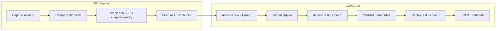

# S3 Next-Gen JPEG Stream — v4.0

A real-time Wi‑Fi display system that sends a dedicated PC UI or video source to a small TFT panel driven by an ESP32-S3. It needs no capture card, no HDMI and no dedicated streaming hardware: an ESP32-S3, a 320×240 SPI TFT and a Wi‑Fi link are enough to push content from a virtual display or app window to a compact embedded screen.

The idea is to create a second virtual display on the PC, render a custom UI or app onto it, capture that display, and transmit it to the ESP32.

**v4.0 is a platform rebase.** The firmware now builds with **pure ESP-IDF** (no Arduino core, no PlatformIO), decodes with Espressif's `esp_new_jpeg`, and streams **one full-frame JPEG per frame** instead of four tiles. See [Migrating from v3](#migrating-from-v3) and `RELEASE_NOTES.md`.


---

## What it does

This project turns a PC into a video sender and an ESP32-S3 into a live receiver/display target.

- The PC captures a monitor (normally a virtual one) and resizes it to 320×240.
- The frame is JPEG-compressed as **one complete image** and sent over Wi‑Fi as indexed UDP chunks.
- The ESP32-S3 reassembles the frame, decodes it block by block straight into a PSRAM framebuffer, and pushes it to the ILI9341 with DMA.
- Touch input on the display is sent back to the PC and translated into mouse actions.

This is not just an "ESP32 video player." It is a remote display / screen mirroring system designed for low-latency, continuous real-time display and touch interaction on a small embedded panel.

Important: the project is designed around a **virtual display** on the PC. The point is to create a second monitor, render the Python UI or any app/window onto it, then capture that virtual display and stream it to the ESP32. It is meant to show a dedicated interface or custom control surface, not to mirror your main monitor.

Quick virtual display driver (VDD) setup on Windows:
1. Install a virtual display driver from https://github.com/VirtualDrivers/Virtual-Display-Driver
2. Open Windows Display settings and enable the new virtual display; it appears as an additional monitor.
3. Start `python captureJpeg.py` and pick that monitor with the `Monitor` slider. The sender then captures the virtual display and streams it to the ESP32.

Typical use cases:
- A wireless secondary display for a PC or console
- A dashboard or monitor for embedded systems
- A hardware lab or demo display
- A touch-enabled second screen for control panels or kiosks
- Sending desktop content to a low-cost ESP32 display device

---

## Main features

- **Pure ESP-IDF firmware** — builds with `idf.py` or the VS Code ESP-IDF extension; no PlatformIO or arduino-esp32 anywhere in the tree
- **Full-frame JPEG streaming** — one JPEG per frame (capped at 35 KiB) split into up to 26 UDP chunks, validated and reassembled on the ESP
- **Block-mode decoding with `esp_new_jpeg`** — 16-row blocks are decoded into a small internal-RAM scratch buffer and copied directly into a free PSRAM framebuffer
- **Explicit buffer ownership** — separate free queues for JPEG slots and display framebuffers; a framebuffer belongs to the display task until its DMA transfer completes, and there are no whole-frame copies
- **Dual-core design** — Core 0 runs network, display DMA, Wi‑Fi watchdog, touch and the OTA server; Core 1 is dedicated to JPEG decoding
- **Adaptive quality on the PC** — the sender targets a 25,000-byte frame budget at a fixed 50 FPS send rate, drops quality immediately (and harder on repeated overflows) when a frame is too large, and climbs back gently after a cooldown
- **Clean failure behaviour** — a frame with a missing chunk, bad JPEG markers or a decode error is discarded whole; the panel keeps showing the last good frame instead of corrupt pixels
- **HTTP OTA updates** — after the first USB flash, push new firmware with a single `curl` command
- **XPT2046 touchscreen as a mouse** (Windows sender)
  - tap = left click
  - slide = scroll (vertical and horizontal, "natural" direction by default)
  - press and hold still, then move = drag; a green ring on the panel shows the drag has armed
  - the PC's real cursor is borrowed for the gesture and returned afterwards
  - compile-time switch `TOUCH_FEATURE_ENABLED` removes touch entirely if you don't have a touch panel
- **Auto-discovery and multi-device** — the ESP broadcasts a beacon; the sender spawns one window/process per discovered ESP and assigns each its own monitor
- **Two live debug overlays** on the PC preview: ESP-side stats (FPS, temperature, jitter, decode time, drops, CPU0/CPU1, SRAM/PSRAM) and PC-encoder stats (encode/send time, frame budget, pacing, quality, overflow/cooldown streaks)

---

## Why this is different from similar projects

| Project | Typical focus | Difference from S3 Next-Gen JPEG Stream |
|---|---|---|
| tinytron | Multimedia streaming and display style projects | This project is centered on live PC screen mirroring over UDP for a small TFT panel with a tight performance budget |
| vPlayer | Local media or streaming player | This is not a general media player; it is a wireless display system that mirrors a desktop or video source with low latency and touch input |
| esp32-tv | ESP32-based TV/display project for various media sources | This project is more like a remote monitor than a conventional media player, emphasizing real-time desktop/video transmission from PC to ESP32 |
| Nomad | Mobile or portable display concepts | This project is a practical display system for screen mirroring and touch-driven interaction, not a broad portable-device concept |
| esp_video (tuupola) | ESP32 video decode work for media sources | This project prioritizes PC-to-ESP live streaming, JPEG frame transport, adaptive quality control, and touch-driven interactivity over a conventional file/video playback pipeline |

The short version:
- Many similar projects are media players or decoders.
- This project is a wireless second display / remote mirror display optimized for latency, simplicity, and touch interaction.

---

## System architecture



The flow is:
1. The PC captures the selected monitor and resizes it to 320×240 (portrait monitors are rotated first).
2. The frame is JPEG-encoded as one image, 4:2:0 chroma, and split into ≤1400-byte UDP chunks with an 8-byte header. Chunks are spaced 250 µs apart to avoid receive bursts.
3. `networkTask` validates each packet, reassembles the frame in a JPEG slot (the first two slots prefer internal SRAM, the rest use PSRAM) and checks the JPEG start/end markers.
4. `decodeTask` takes a free display framebuffer and decodes the JPEG block by block into it.
5. `displayTask` pushes the finished framebuffer to the LCD with DMA and returns it to the free queue when the transfer completes.
6. If the panel is touched, the ESP sends raw touch events back to the PC, which turns them into mouse actions.

---

## Hardware

| Item | Details |
|---|---|
| MCU | ESP32-S3 dual-core, 16 MB flash (QIO), 8 MB Octal PSRAM (N16R8) |
| Display | ILI9341, 320×240 SPI TFT |
| Network | Wi‑Fi 802.11n, HT20, single stream |
| Touch panel | XPT2046 on the same SPI bus as the display (optional) |
| PC side | Windows, Python + OpenCV + MSS + NumPy + psutil |

Pin wiring, SPI bus layout, touch calibration and the memory budget are in [HARDWARE.md](HARDWARE.md).

---

## Getting started

### Requirements

- **ESP-IDF** — the component manifest requires v5.1 or newer; the project was developed against **v6.1**. Install it with the [VS Code ESP-IDF extension](https://marketplace.visualstudio.com/items?itemName=espressif.esp-idf-extension) setup wizard or manually per Espressif's Get Started guide.
- Target `esp32s3`. `sdkconfig.defaults` assumes an **N16R8** board (16 MB QIO flash + 8 MB Octal PSRAM); see [If your board isn't N16R8](#if-your-board-isnt-n16r8).
- `git` on your PATH and internet access **on the first build only**: the component manager fetches `espressif/esp_new_jpeg` (component registry) and LovyanGFX 1.2.33 (from GitHub) into `managed_components/`.
- Python 3 on the PC for the sender.

### Before you flash — edit `main/nexus.h`

All settings you need for your network and wiring are in `main/nexus.h`, Zone 1:

| Macro | Purpose |
|---|---|
| `WIFI_SSID` / `WIFI_PASS` | Your Wi‑Fi network. The defaults in the repository are placeholders from the author's setup — **replace them, and don't commit your own credentials** |
| `WIFI_TX_POWER` | Max transmit power in 0.25 dBm units (`80` requests 20 dBm, `20` requests 5 dBm). Actual output may be clamped by the chip and regional regulations |
| `OTA_HOSTNAME`, `OTA_HTTP_PORT` | Hostname advertised on the network and the HTTP OTA port (default `3232`) |
| `LCD_PIN_*`, `LCD_WRITE_HZ`, `LCD_SPI_HOST` | Panel wiring and SPI clock (default 75 MHz) |
| `TOUCH_PIN_*`, `TOUCH_SPI_HZ` | Touch controller wiring |
| `TOUCH_FEATURE_ENABLED` | `1` = touch setup, calibration, sampling and touch networking are compiled in; `0` = all of it is removed |
| `TOUCH_USE_IRQ` | Leave at `0` unless PENIRQ is actually wired — see [HARDWARE.md](HARDWARE.md), this is not just a performance knob |

Zones 2–3 (display geometry, pipeline depth, timing, touch tuning) have sane defaults for a 320×240 panel and normally need no changes.

### Build and flash

Open the folder in VS Code with the ESP-IDF extension, select `esp32s3` as the target, then use the extension's build / flash / monitor buttons — or from a terminal with the IDF environment sourced:

```sh
idf.py set-target esp32s3
idf.py build
idf.py -p <PORT> flash monitor
```

The first build triggers the component-manager fetch and takes noticeably longer than later builds.

### Touch calibration

When touch is enabled, calibration is stored in NVS and reused after power cycles. On the first boot (or after erasing NVS / changing the calibration format) the panel shows a 4×4 grid of targets to tap. To recalibrate later, **double-press BOOT before streaming starts**.

### Firmware updates over Wi‑Fi (OTA)

OTA is a small HTTP endpoint (`main/ota.cpp`) that writes into the `app0`/`app1` OTA partition pair:

```sh
idf.py build
curl -X POST --data-binary @build/s3_nextgen_jpeg.bin http://<device-ip>:3232/update
```

`<device-ip>` is shown on the panel's Wi‑Fi status line and in the serial monitor. The mDNS hostname depends on your OS and network; the plain IP always works. The device reboots automatically when the upload succeeds.

### Run the PC sender

```bash
pip install -r requirements.txt
python captureJpeg.py
```

Turn on a Windows hotspot (or use your normal network) with the same SSID/password the ESP is configured for. The sender listens for the ESP's `S3READY` beacon, auto-discovers every ESP32-S3 running this firmware on the local network, and starts streaming. No manual IP entry is required.

---

## Python UI controls and how to use them

Each discovered ESP gets its own preview window with four sliders. The send rate is fixed at 50 FPS and the encoder always works toward its quality ceiling, so there is nothing else to tune.

| Control | Range | What it does |
|---|---|---|
| `Sharpen` | 0–20 (default 10) | Edge sharpening applied before encoding. `0` disables it |
| `Debug Mode` | 0 / 1 / 2 | `0` = clean preview, `1` = ESP-side stats overlay, `2` = PC encoder stats overlay |
| `Enable Touch` | 0 / 1 | Lets the ESP touchscreen drive this PC's mouse. When off, the ESP stops sending touch events at the source |
| `Monitor` | 1…number of monitors | Which screen to capture. Changing it moves this ESP to another display live; each ESP claims a different monitor by default |

How to operate it in practice:

1. Start `python captureJpeg.py`.
2. Connect the ESP32-S3 to the same network as the PC.
3. The app discovers the device and opens a window for it.
4. Use `Monitor` to select the display you want to stream (typically the virtual display).
5. Adjust `Sharpen` if the image looks too soft or too harsh.
6. Use `Debug Mode` 1 or 2 when you want live diagnostics; set it back to `0` for a clean preview.
7. Turn on `Enable Touch` to use the panel as an input device. Press `Q` in the preview window to quit.

`Sharpen`, `Debug Mode` and `Enable Touch` are stored in `settings.json` next to the script and restored on the next run. The `Monitor` choice is not persisted.

### Touch gestures

| Gesture | Result |
|---|---|
| Quick tap | Left click at that point |
| Slide past a few pixels | Scroll wheel (axis locks to the dominant direction when the slide starts) |
| Press and hold still (~0.4 s), then move | Press-and-hold drag; a green ring on the panel confirms the drag is armed |

A press commits to exactly one of the three. Touch injection uses the Windows `SendInput` API, so touch control requires a **Windows** PC. If the ESP stops reporting during a drag, the sender releases the mouse button after 2 s so a dropped link can never leave the desktop stuck mid-drag.

---

## Project structure

```text
CMakeLists.txt              root ESP-IDF project file
sdkconfig.defaults          baked-in Kconfig defaults for the N16R8 board
partitions_16MB_ota.csv     NVS + otadata + app0/app1 (OTA) + spiffs
main/
  CMakeLists.txt            registers every source file and component dependency
  idf_component.yml         component-manager dependencies (esp_new_jpeg, LovyanGFX)
  nexus.h                   ← main configuration: Wi‑Fi, pins, timing, buffers, shared state
  app_main.cpp              entry point: init, buffer allocation, task creation, decodeTask
  wifi.cpp/.h               NVS init + native esp_wifi station
  network.cpp/.h            UDP receive, frame reassembly, stats/touch packets, Wi‑Fi watchdog
  jpeg_decode.cpp/.h        esp_new_jpeg block decode into the PSRAM framebuffer
  display.cpp/.h            LovyanGFX ILI9341 driver, status lines, DMA display task
  touch.cpp/.h              XPT2046 reading, calibration, touch event reporting
  ota.cpp/.h                HTTP OTA endpoint
  port.h                    millis()/micros()/delay()/constrain() over esp_timer/FreeRTOS
unity-app/                  Unity test-app skeleton (placeholder, no tests yet)
captureJpeg.py             PC sender: capture, encode, send, touch injection, preview UI
requirements.txt            Python dependencies
settings.json               saved sender UI settings
HARDWARE.md                 wiring, SPI, touch, memory budget
RELEASE_NOTES.md            version history
```

`main/nexus.h` is the central firmware configuration file: nearly every user-editable setting, buffer size, timing value and shared struct lives there. A fuller file-by-file guide is in `PROJECT_STRUCTURE_AND_EXPLANATION.md`.

---

## Detailed technical notes

### 1) Frame transport

- The PC sends **one JPEG per frame**, capped at `MAX_JPEG_FRAME` = 35 KiB, in chunks of up to 1400 bytes (at most 26 chunks).
- Every packet carries an 8-byte header (see the table below). The ESP checks that the chunk count, chunk index, chunk length and total size are mutually consistent before accepting a packet.
- A completed frame must start with the JPEG SOI marker (`FF D8`) and end with EOI (`FF D9`).
- A frame that is not complete within 80 ms of its first chunk is dropped.
- UDP is best effort: a missing chunk invalidates that frame, which is discarded rather than partially shown.

### 2) Wire protocol (UDP port 12345)

| Direction | Bytes | Meaning |
|---|---|---|
| PC → ESP | `AA BB <frameId> <chunkId> <nChunks> <flags=0> <sizeHi> <sizeLo> <payload…>` | One chunk of a JPEG frame |
| PC → ESP | `AA CC 01 <0\|1>` | ESP debug stats off/on |
| PC → ESP | `AA CC 02 <0\|1>` | Touch reporting off/on |
| ESP → PC | `AB CD FPS:…\|TEMP:…\|JIT:…\|DEC:…\|DROP:…\|ABRT:…\|SRAM:…\|PSRAM:…\|CPU0:…\|CPU1:…` | Debug stats text (about every 300 ms while enabled) |
| ESP → PC | `AA DD <kind> <touchId> <seq> <xHi> <xLo> <yHi> <yLo>` | Touch event: DOWN / MOVE / UP (kind 0 / 1 / 2) |
| ESP → broadcast | `S3READY` | Discovery beacon, sent every 2 s while no packets are arriving |

### 3) Dual-core execution

| Core | Tasks |
|---|---|
| Core 0 | `networkTask` (prio 3), `displayTask` (prio 3), `wifiWatchdogTask` (prio 1), `touchTask` (prio 1), HTTP OTA server |
| Core 1 | `decodeTask` (prio 2) |

`app_main()` creates the tasks and returns; there is no Arduino `loop()`.

### 4) Memory pipeline

- Three full-frame JPEG slots of up to 35 KiB each: the first two prefer internal SRAM (with PSRAM fallback), the third uses PSRAM.
- Three display framebuffers of 320×240×2 bytes in PSRAM.
- A 10 KiB, 16-byte-aligned block scratch buffer in internal SRAM for the decoder.
- If an allocation fails at startup, the firmware retries with fewer slots/buffers (down to 1 JPEG slot and 2 framebuffers) before halting with an on-screen error.

### 5) Adaptive quality control (PC side)

- Quality ceiling is 80; the frame budget is 25,000 bytes. The sender never exceeds the 35 KiB protocol cap (it re-encodes at lower quality if needed).
- A frame over budget drops quality at once: 6 points for the first overflow, +8 for each consecutive overflow, up to 40 at a time (minimum quality 5).
- Quality climbs back one point at a time, only after the smoothed (EMA) frame size has stayed under 90% of the budget for 3 consecutive frames.

### 6) Touchscreen

- XPT2046 on the display's SPI bus; a mutex gives the display priority so a touch read can delay a frame by at most one ~456 µs read.
- 4×4-point bilinear calibration with automatic retry if the fit residual is too large (details in [HARDWARE.md](HARDWARE.md)).
- The ESP reports raw DOWN/MOVE/UP only; every gesture decision happens in `captureJpeg.py`, so gestures can be retuned without reflashing.

### 7) OTA and diagnostics

- HTTP OTA writes to the inactive OTA slot, validates the image, switches the boot partition and reboots.
- `displayTask` is registered with the task watchdog (5 s).
- Debug overlays are described in the UI controls section above.

---

## Migrating from v3

v4.0 is **not** wire- or build-compatible with v3.

- Flash the new firmware **over USB** once (`idf.py -p <PORT> flash`). The old PlatformIO `espota` flow no longer exists.
- Update the PC sender and the ESP firmware **together**; the old tile-based sender will not work with the new firmware, and vice versa.
- `platformio.ini`, `src/`, `lib/JPEGDEC` and `shared.h`-era files are gone; configuration lives in `main/nexus.h` and `sdkconfig.defaults`.
- The old `Priority` and `Show Stats` sliders are replaced by `Debug Mode` (0/1/2); old `settings.json` entries for them are ignored.
- A touch calibration saved by the v3 firmware is still readable (same NVS namespace, key and format).

---

## If your board isn't N16R8

`sdkconfig.defaults` hardcodes 16 MB QIO flash and 8 MB Octal PSRAM at 80 MHz. For a different flash size or PSRAM mode (Quad instead of Octal, for example), run `idf.py menuconfig` → `Serial flasher config` and `Component config → ESP PSRAM`, adjust, then copy the changes into `sdkconfig.defaults` if you want them to survive a clean rebuild. Also update `partitions_16MB_ota.csv` if the flash size differs.

## Troubleshooting a fresh build

- **"could not resolve component 'X'"** — a component name shifted between IDF versions. Add the missing name to the `REQUIRES` list in `main/CMakeLists.txt` (the file has a note on this).
- **"unknown kconfig symbol" warning** — same drift, in `sdkconfig.defaults`. Open `idf.py menuconfig`, search (`/`) for the setting by description, and fix that one line.
- **LovyanGFX fails to fetch** — `main/idf_component.yml` pulls it from GitHub (pinned to 1.2.33); it needs `git` on PATH and network access on the first configure.
- **Console output** — logs go to UART0 at 115200 baud by default. If your board only exposes the native USB port, switch to `CONFIG_ESP_CONSOLE_USB_CDC` in `sdkconfig.defaults`.
- **Touch seems dead** — check that `TOUCH_USE_IRQ` is `0` unless PENIRQ is genuinely wired, and that `TOUCH_FEATURE_ENABLED` is `1`.

---

## Known limitations

- Wi‑Fi throughput is limited by the ESP32-S3's single-stream radio path.
- Complex or high-motion scenes produce larger JPEGs and are harder to decode in real time; the sender trades quality for frame size automatically.
- The system uses intra-frame JPEG only; there is no motion compensation or frame-to-frame delta compression.
- The ESP32-S3 has no hardware video decoder, so decoding is done by the CPU.
- A lost UDP chunk costs the whole frame (the previous frame stays on screen).
- The sender's capture, monitor selection and touch injection target Windows.

This makes the project ideal for screen mirroring, remote displays, and interactive embedded dashboards rather than a full-featured media player or a high-end hardware video decoder.

---

## License

No license file is included in the repository at the time of this release. Add one before redistributing or reusing the code commercially. LovyanGFX and `esp_new_jpeg` are third-party components with their own licenses.