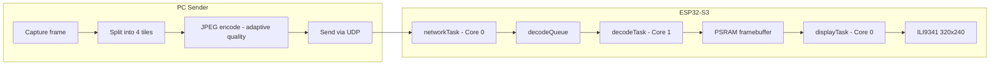

# S3 Next-Gen JPEG Stream

This project is a real-time Wi‑Fi display system that sends a separate PC UI or video source to a small TFT panel driven by an ESP32-S3. It does not rely on a capture card, HDMI, or dedicated streaming hardware. It uses an ESP32-S3, a 320×240 SPI TFT, and a Wi‑Fi link to push content from a dedicated virtual display or app window to a compact embedded screen.

This project is meant to create a second virtual display on the PC, render a custom UI or app there, capture that virtual display, and transmit it to the ESP32.


---

## What it does

In short, this project turns a PC into a video sender and an ESP32-S3 into a live receiver/display target.

- The PC captures its screen or a video source.
- Each frame is split into 4 tiles.
- The tiles are JPEG-compressed and sent over Wi‑Fi using UDP.
- The ESP32-S3 reassembles the tiles, decodes the JPEG payload, and draws the final frame on a 320×240 ILI9341 TFT.
- Touch input on the display is sent back to the PC and translated into mouse actions.

This is not just an "ESP32 video player." It is a remote display / screen mirroring system designed for low-latency, continuous real-time display and touch interaction on a small embedded panel.

Important: this project is designed around a virtual display on the PC. The point is to create a second monitor, render the Python UI or any app/window onto it, and then capture that virtual display and stream it to the ESP32. This is why the project exists: it is meant to display a dedicated interface or custom control surface, not to mirror your main monitor.

Quick VDD setup guide:
1. Install a virtual display driver (VDD) on Windows from https://github.com/VirtualDrivers/Virtual-Display-Driver
2. After installation, open Windows Display settings and enable the new virtual display; it should show up as an additional monitor.
3. Start `python captureJpeg.py` and select that monitor in the sender UI. The capture code will then grab the virtual display and stream that display to ESP32.


Typical use cases:
- A wireless secondary display for a PC or console
- A dashboard or monitor for embedded systems
- A hardware lab or demo display
- A touch-enabled second screen for control panels or kiosks
- Sending desktop content to a low-cost ESP32 display device

---

## Main features

- Real-time Wi‑Fi display at up to about 35 FPS at 320×240
- Adaptive image quality control: the sender watches frame payload sizes and adjusts JPEG quality to match available network and ESP performance
- 4-tile parallel decoding so the decoder does not stall while waiting for data
- Dual-core ESP32-S3 design with FreeRTOS task separation between cores
- Automatic frame recovery when a tile fails or arrives too late, using the last valid pixels instead of showing broken output
- OTA firmware updates so you do not need a USB cable after the first flash
- XPT2046 touchscreen acting as a mouse for the mirrored PC
  - single tap = left click
  - drag / slide = scroll
  - press-and-hold, then move = drag window contents
  - useful for interactive control interfaces
- Live diagnostics overlay on the PC side showing FPS, decode time, CPU load, temperature, memory usage, and dropped-frame counters

---

## Why this is different from similar projects

| Project | Typical focus | Difference from S3 Next-Gen JPEG Stream |
|---|---|---|
| tinytron | Multimedia streaming and display style projects | This project is centered on live PC screen mirroring and tile-based UDP streaming for a small TFT panel with a tight performance budget |
| vPlayer | Local media or streaming player | This is not a general media player; it is a wireless display system that mirrors a desktop or video source with low latency and touch input |
| esp32-tv | ESP32-based TV/display project for various media sources | This project is more like a remote monitor than a conventional media player, emphasizing real-time desktop/video transmission from PC to ESP32 |
| Nomad | Mobile or portable display concepts | This project is a practical display system for screen mirroring and touch-driven interaction, not a broad portable-device concept |
| esp_video (tuupola) | ESP32 video decode work for media sources | This project prioritizes PC-to-ESP live streaming, JPEG tile transport, adaptive quality control, and touch-driven interactivity over a conventional file/video playback pipeline |

The short version:
- Many similar projects are media players or decoders.
- This project is a wireless second display / remote mirror display optimized for latency, simplicity, and touch interaction.

---

## System architecture



The flow is:
1. The PC captures a frame or video source.
2. The image is split into 4 tiles.
3. Each tile is JPEG-encoded and packetized over UDP.
4. The ESP32-S3 receives the chunks and reassembles them.
5. The JPEG image is decoded directly into the PSRAM framebuffer.
6. The final frame is pushed to the LCD using DMA.
7. If the panel is touched, the ESP sends the touch data back to the PC, which turns it into mouse events.

---

## Hardware

| Item | Details |
|---|---|
| MCU | ESP32-S3 dual-core, 16 MB flash, 8 MB PSRAM |
| Display | ILI9341, 320×240 SPI TFT |
| Network | Wi‑Fi 802.11n |
| Touch panel | XPT2046 on the same SPI bus as the display |
| PC side | Python + OpenCV + MSS + NumPy |

More detail on pin wiring, SPI bus layout, and memory allocation is in [HARDWARE.md](HARDWARE.md).

---

## Getting started

This project requires [PlatformIO](https://platformio.org/).

Before the first flash, open [src/nexus.h](src/nexus.h). That is the main configuration file for Wi‑Fi settings, panel pins, touch configuration, and runtime behavior.

```bash
# First flash over USB
# (uncomment upload_protocol = esptool in platformio.ini first)
pio run -t upload

# Later flashes over OTA
# (default configuration: upload_protocol = espota)
pio run -t upload
```

The PC-side sender lives in `captureJpeg.py`:

```bash
pip install -r requirements.txt
python captureJpeg.py
```

The sender auto-discovers any ESP32-S3 running this firmware on the local network and starts streaming automatically. No manual IP entry is required.

---

## Python UI controls and how to use them

The Python control window is the main user interface for the sender. Each discovered ESP gets its own control window with trackbars and settings that directly affect the live stream.

The most important settings are:

| Setting | How to use it | What it changes |
|---|---|---|
| `Priority` | Move the slider to choose a preset such as `MAX FPS`, `FAST`, `BALANCED`, `QUALITY`, or `MAX QUALITY` | Sets the target byte budget and maximum quality ceiling for adaptive JPEG control |
| `Sharpen` | Increase the value for a crisper image, or set it to `0` to disable sharpening | Applies edge sharpening to the live image before transmission |
| `Show Stats` | Set to `0` for a clean preview, `1` to show the live overlay | Toggles the performance debug overlay (FPS, decode time, CPU load, temperature, memory, and drop counters) |
| `Enable Touch` | Set to `1` to let the ESP display act as a mouse, or `0` to ignore touch input | Enables or disables touchscreen-to-PC mouse control |
| `Monitor` | Pick the screen you want to capture if multiple displays are connected | Selects which monitor is streamed to the ESP32 |

How to operate the UI in practice:

1. Start `python captureJpeg.py`.
2. Connect the ESP32-S3 to the same Wi‑Fi network as the sender.
3. The app discovers the device automatically and opens a control window for it.
4. Adjust `Priority` first for the overall streaming balance between speed and image quality.
5. If the image looks too soft or edges are too harsh, adjust `Sharpen`.
6. Turn on `Show Stats` when you want to see live network/decoder performance.
7. Turn on `Enable Touch` if you want to use the display as an input device for the PC.
8. Use `Monitor` to select the correct screen if your machine has more than one display.

The settings are stored in `settings.json`, so your last-used values persist between runs.

---

## Project structure

```text
src/
  nexus.h             ← main configuration: Wi‑Fi, pins, timing, buffers
  main.cpp            entry point and task orchestration
  network.cpp/.h      UDP receive, tile reassembly, Wi‑Fi watchdog
  jpeg_decode.cpp/.h  JPEG decode into PSRAM framebuffer
  display.cpp/.h      LovyanGFX + DMA display driver
  touch.cpp/.h        XPT2046 reading, calibration, touch event reporting
captureJpeg.py         PC sender: capture, encode, send, and control UI
requirements.txt       Python dependencies
HARDWARE.md            wiring, SPI configuration, memory budget
platformio.ini         PlatformIO build configuration
```

`src/nexus.h` is the central firmware configuration file. Most runtime settings, hardware pins, buffer sizes, and timing values are defined there.

---

## Detailed technical notes

### 1) Tile transport and adaptive compression

- Each frame is split into 4 tiles.
- Each tile is JPEG-compressed before transmission.
- The ESP32-S3 reassembles the tiles before decoding.
- The sender adjusts JPEG quality per-frame to stay within a target byte budget and avoid backlog.

### 2) Dual-core execution

- Core 0 handles networking, display DMA, OTA, and watchdog functions.
- Core 1 is dedicated to JPEG decoding.
- Tasks are separated intentionally so network receive and decode processing do not interfere with each other.

### 3) Adaptive quality control

The sender uses frame size feedback to adapt JPEG quality in real time:
- If the connection becomes congested or the decoder falls behind, quality is reduced.
- If conditions recover, quality gradually increases again.
- This keeps the stream stable under changing workload and network conditions.

### 4) Touchscreen interaction

The touchscreen is one of the key differentiators of this project:
- The XPT2046 touch sensor is read on the same SPI bus as the display.
- Calibration is done to map raw touch positions to the correct display coordinates.
- Touch gestures are translated into mouse actions on the PC.
- This makes the display usable as a remote interactive panel without an external USB mouse.

### 5) OTA and diagnostics

- The project supports OTA updates after the first USB flash.
- The PC-side sender shows a live overlay with FPS, decode time, CPU load, temperature, memory use, and dropped-frame data.

---

## Known limitations

- Wi‑Fi throughput is limited by the ESP32-S3 single-stream radio path.
- Complex or high-motion scenes are harder to decode in real time.
- The system uses intra-frame JPEG encoding only; it does not use motion compensation or frame-to-frame delta compression.
- The ESP32-S3 has no dedicated hardware video decode block, so the workload is handled by the CPU.

This makes the project ideal for screen mirroring, remote displays, and interactive embedded dashboards rather than a full-featured media player or a high-end hardware video decoder.

---

## License

This project is released under an open-source embedded/hobby project-friendly license such as MIT. Please check the repository license file before commercial reuse or redistribution.
